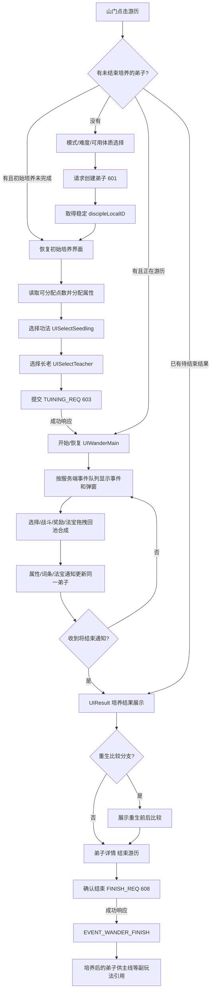

# 游历核心流程重新定位

核对日期：2026-10-19。当前复刻重点为**游历培养弟子**；主线是使用培养成果进行关卡挑战的副玩法。本报告只重新界定流程、数据边界和替换顺序，没有将新布阵草稿接入网页。

## 结论

普通游历以**一名正在培养的弟子及其稳定 LocalID**为中心。从创建、初始属性分配、功法和长老选择，到事件、背包装备、词条、战斗、渡劫和最终培养结果，操作都围绕同一个弟子对象展开。不是从三名现成弟子中选阵容，也不是只在结尾领货币的独立闯关。

培养期间，属性、法宝、词条等由各自通知持续更新到同一弟子；结束页展示该弟子当前培养成果。主线布阵随后引用已培养弟子的 LocalID，不能替代这条核心循环。

## 证据版本与可信边界

| 材料 | 身份 | 可确认范围 |
| --- | --- | --- |
| 原 APK | `wydlz_1.0.2609101116_20260917_030401_64981.apk`；SHA256 `5be3e3f7936591f2daf8c3eed9b444b9f03d179e878e8dc16c0e0a896f45a15d` | 原包资源和旧版客户端静态逻辑 |
| 旧版程序集 | `work/apk-analysis/text-assets/1560_Assembly-CSharp`；SHA256 `f65665858eb67c0e9dadf6992931db0c1013a1d2ee70590480def04de29bc6f8` | 现有 `wander-source/*.cs` 反编译流程的来源 |
| 模拟器热更程序集 | `work/alignment-v9/runtime/text-assets/2yad24y_Assembly-CSharp`；SHA256 `c0c9533b719ae312542d6e9fda26f0f7627fb828c474681a20986bba7ccfb2b8`；MVID `562f0f82-5611-43bc-8ed2-c95ed2c6af1e` | 新版类型、方法、字段访问、调用关系和指定 getter 的 IL |
| 模拟器当前资源 | 已识别热更版本 `2610131532` | 运行采集应继续以这版为基准；本报告没有取得真实游历网络包 |

旧版 C# 可说明具体流程；新版静态分析已确认关键类型和调用仍存在，但尚未逐方法重新反编译证明所有分支完全一致。下文涉及旧版消息编号、界面分支和字段时保留这个边界。静态客户端逻辑不能证明服务端随机、奖励、伤害及培养数值。

本次 REA 保留证据：

- `ev_dc3c408824ed2e9ef48502ca4202e31376719bca7825aca6974adfaf163c820c`：新版 `WanderModule`、`WanderModuleMessageHandler`、`DiscipleData`，3 个类型、271 个方法，选择范围无未匹配类型。
- `ev_ee677d9b4afb27ed0bdee82ca78aebd987284e627b5b43d26dfd4add9304377e`：上述方法页，包含关键 getter 与调用锚点。
- `ev_baddd4f83051a84bbf553d4fdd1db4925a5789238ded6f7c85016eccc1240c6d`：新版 `HeroModuleMessageHandler`、`BaseDiscipleData`。请求的 `GameScripts.ImmortalFamily.Hero.EnDiscipleProp` 未匹配，不把该枚举命名空间当作已确认。

所有元数据 token 仅对上述新 DLL 的 SHA256/MVID 有效，不能跨版本直接复用。

## 正确状态流程

图中是客户端生命周期；未知服务端结果仍须等待真实响应。事件间不能仅凭固定秒数自动跳到下一状态。

## 初始选择与数据来源

`WanderModule.EnterWander`（旧源码 `WanderModule.cs:274`）遍历 `Hero.GetAllDisciple()`，先找 `!IsWanderFinish` 的弟子，再区分 `IsTuiningFinish`、死亡和待结束状态。没有进行中的培养对象才打开 `UIDiscipleBirth(hasDisciple:false)`。

`UIDiscipleBirth.OnBtn_OpenClicked`（`UIDiscipleBirth.cs:923`）进入创建分支。旧消息 `DISCIPLE_BUILD_DISCIPLE_REQ`（601）发送所选难度、模式和体质属性；`DISCIPLE_BUILD_DISCIPLE_RSP` 成功后返回 `iDiscipleLocalID`，`WanderModuleMessageHandler.cs:134` 将其传给 `SetWanderDisciple`。

可分配点数来自弟子数据，旧 `UIDiscipleBirth.InitPoints`（570–573 行）读取 **属性键58**，再调用 `DiscipleAllocPoint.InitPoints`，不是客户端常量5。属性点转换通过 `CalculatePropUtils.GetTrsPropValue`，不能以固定攻击+2、防御+2、生命+25替代。

初始确认（`UIDiscipleBirth.cs:1016`）打开 `UISelectSeedling`，下一步进入 `UISelectTeacher`。`UISelectTeacher.ConfirmWander` 对未选择长老的情况弹确认提示，随后调用 `DiscipleUtility.OnClickConfirmWanderBtn`，该方法发送 `TUINING_REQ`。成功响应才 `StartWander()`。

`SetTuiningData`（`WanderModuleMessageHandler.cs:1144`）提交：

| 字段 | 含义 |
| --- | --- |
| `iDiscipleLocalID` | 当前培养弟子身份 |
| `iSeedingID`、`iSeedingID_A/B` | 功法选择 |
| `iTeacher_A/B` | 长老选择 |
| `arrAttribute` 的 key/value | 实际分配属性点 |
| `iIsWanderQuickly` | 普通/快速分支标识 |

新版 IL 已确认 `DiscipleData.IsWanderFinish` 读取属性键4并判断等于1；`IsTuiningFinish` 读取键50并判断等于1。不能仅靠网页是否存在 `run` 对象代替这些不同状态。

## 逐关事件、法宝和弟子写回

旧 `WanderEventManager.HandleEventLogNTF` 从事件日志读取 `iEventID`、`iStageID`、`iOrder`、`iStartFlag`、`iEndFlag` 及 actions，入队后由 `HandleQueueEvent` 处理。装备、词条、灵宠等还有各自专门的选择通知和请求。原版弹窗的触发单位是这些事件与通知，不是随意拼接的前端奖励队列。

新版 `HeroModuleMessageHandler` 调用关系确认以下通知均转给 `Role.OnReceiveServerMessage`：

- `DISCIPLE_CREATE_NTF`、`DISCIPLE_UPDATE_PROP_NTF`。
- `DISCIPLE_ADD_ABILITY_NTF`、`DISCIPLE_REMOVE_ABILITY_NTF`。
- `EQUIP_CREATE_NTF`、`EQUIP_UPDATE_PROP_NTF`、`EQUIP_DELETE_NTF`。

新版 `BaseDiscipleData` 有 `SetAllProp/SetIntProp`、`Add/Update/DeleteBagEquip`、`GetAllOwnerBagEquip/GetAllWearBagEquip`、`Add/RemoveAbility` 等方法。因此应将弟子属性、所属法宝、摆放和词条作为同一培养对象的持续状态。全局货币背包与弟子自己的游历法宝背包必须分开；法宝回池也不是直接变成全局商品。

尚需逐方法核对的部分包括：Role 下具体承接通知的 Part、每种装备位置/所有者字段、合成结果与数量批次、结束时保留或转化哪些临时字段。不得从方法存在推断所有字段和到账时序已恢复。

## 结束、重生与副玩法关联

旧 `WANDERING_WILL_FINISH_NTF`（`WanderModuleMessageHandler.cs:313`）先核验 LocalID，再调用 `EndWander`、`ShowResult`。`UIResult` 读取现有弟子的功法、词条、品质、评分和战力；战力数字存在2秒展示动画，这属于表现时长，不能反推服务端培养时长。

`WanderModule.ResultNext` 检查重生状态，必要时打开前后比较。`WanderEndShowDiscipleInfo`（727 行）展示已有弟子的“结束游历”详情；用户确认才进入 `ReqCloseWander`（752 行）→ `FINISH_REQ`（608）。成功响应触发 `EVENT_WANDER_FINISH`。

`StageBattleCustomize.GetDefaultDisciples` 读取阵容16中的弟子 LocalID；挑战前 `RequestSetFormation(16, ids)` 后发送主线挑战请求。这是培养结果的使用端，不应拥有另一套互不相通的初始弟子和培养公式。

## 当前网页与原始逻辑的具体偏差

以下行号依据本次读取的 `outputs/laozu-web/game.js`，后续编辑会使行号移动。

| 当前实现 | 证据位置 | 问题 | 正确替换方向 |
| --- | --- | --- | --- |
| 默认赠送林青玄、300灵石、20悟道及共享法宝 | 17 行 | 原型初始值未来自本次原版账号或创建响应 | 导入已确认账号快照，或由创建流程产生培养对象 |
| `newRun.config.disciple=state.selected` | 114 行 | 把一局游历绑定现成弟子下标，缺稳定 LocalID | 建立创建/恢复同一培养弟子的状态 |
| 出生弹窗使用 `state.disciples` 下拉框“出战弟子” | 219 行 | 将培养入口误作成品弟子选择 | 按原版恢复出生、模式/难度及创建结果 |
| 总点数固定5，随机固定 `[2,1,2,0]` | 162–164、219 行 | 点数和随机结果没有原版数据依据 | 读取弟子属性键58；随机和转换依据原逻辑或真实结果 |
| `flowStats` 用固定加成及本地战力公式 | 113 行 | 临时配置叠到全局英雄上，非持久弟子成长数据 | 先恢复同一弟子属性/词条/装备更新，再接原始计算链 |
| 战斗血量、攻速、伤害随步数合成 | 214、249 行 | 本地公式不是原版逐回合战报 | 用原始战斗上下文和逐行动消息驱动 |
| `finishWander` 直接加500/600灵石与100/120晶体，失败折半 | 213 行 | 固定结算奖励无真实通知依据 | 奖励通知、全局钱包变化、弟子完成状态分开处理 |
| `finish-run` 清空run，仅增加cleared计数 | 184 行 | 没有将本局功法、词条、属性及法宝完整写回培养弟子 | 结束保留培养成果；处理完成标记和可用性，再清理临时表现状态 |
| 所有弟子共用 `state.inventory` | 17、89–106、149–151 行 | 不能表达法宝所有者、弟子独立背包和培养结果 | 按 LocalID 维护所属法宝及摆放，和全局背包明确映射 |

“结束仅货币”在这里指**结算没有完整弟子培养成果写回**，不是说网页完全没有法宝或词条选择表现。现有局内表现可作为待替换UI参考，不能视为原始数据链已完成。

## 下一步逐步替换顺序

1. **先采运行基线。** 在当前模拟器记录一次普通游历：入口状态、模式/难度、体力前后、创建的新弟子、出生可分点数、功法和长老选择、第一事件、第一批法宝奖励、回池/合成、多批领取、结束详情。不中途重置账号、不把主线布阵当游历入口。
2. **恢复身份与状态模型。** 统一账号弟子表、培养中 LocalID、完成/初始培养标记；区分账号快照、真实通知与受控测试数据。停止依赖数组下标和默认赠送角色。
3. **替换初始培养流程。** 先把创建/恢复、点数、功法、长老及请求成功后进入游历接通；UI用对应原始预制体和坐标适配。
4. **替换第一段事件及奖励状态机。** 以日志顺序和通知推进；保持游历场景底层，只在对应时机显示弹层。先完整验证一批法宝的出现、入包、回池、合成、继续领取，再扩大事件覆盖。
5. **建立持续弟子写回。** 逐一对齐属性、能力、法宝创建/更新/删除及格子状态；验证刷新恢复、重复通知和奖励批次不重复入账。
6. **恢复游历战斗。** 仅在取得原始上下文和逐回合/逐行动证据后接动画与数值；无法观察到的服务端随机保持待核，禁止由主线或原型公式代填。
7. **完成培养结束闭环。** 结果动画→重生比较分支→弟子详情→确认结束→完成响应；逐字段核验最终弟子、全局奖励和临时局内状态的去留。
8. **最后连到副玩法。** 让主线阵容读取上述培养后的同一弟子，验证身份和战力来源一致，避免平行存档模型。

## 已确认与待运行

已确认：旧版客户端生命周期、创建和培养请求字段、事件日志队列、结果/结束分支；新版关键类/方法、通知路由、持续装备/词条接口及状态键4/50；当前网页的上述具体偏差。

待运行：热更版普通游历每个弹窗的实际坐标与触发先后；当前账号出生点数和属性换算；真实各批法宝与掉落；回池/合成服务端结果；原始逐回合战报；培养结束后的完整字段、首次奖励和到账先后。以上没有在本报告中冒充完成。

本次尝试的临时 Frida 注入没有成功取得战报，目标进程曾退出；根代理已停止该临时进程。本报告没有依赖注入结果，后续按正常运行可观察的证据继续核对。

## 本轮追加实机证据

已正常操作原版游历至道历4年，实测20点分配、主辅功法、两位长老、多批法宝拖拽、三选一神通、完整斗法尾段及同类法宝合成。见[实机核对记录](游历实机核对/实机核对记录.md)与[运行观察数据](游历实机核对/运行观察数据.json)。20点是样本值，不是全局默认值。战后日志已证实恢复10%已损失生命值，应从“未验证假设”更新为“运行界面已确认，整数取整未捕获”。仍未取得真实逐回合数据包。
